# vidcap_pynqz2

**Version 1.3.0** (see `VERSION`)

HDMI video capture, live filtering and display for the **PYNQ-Z2** (Zynq-7020), controlled from Jupyter.

> **Teaching or learning?** The [technical guide](#technical-guide-video-modes-and-image-processing-in-hardware) at the end of this file is a textbook-style
> explanation of video modes, HDMI, streaming hardware, image filters, temporal averaging and colour grading, with diagrams, using this project as the worked example.

```
HDMI in ─► [test pattern / HDMI select] ─► snapshot ─► DDR ─► filter ─► timestamp ─► HDMI out
                                                          ▲
                                         video memory ────┘ (show any image of the mode's size instead)
```

* **Format:** 24-bit colour, one bitstream per video mode, output matches the input (see *Video modes*):
  `720p` 1280x720, `480p` 720x480, `240p` 1440x240, `xga` 1024x768 (all at about 60 Hz) and `1080p30` 1920x1080 at 30 Hz.
* **Snapshot:** software-triggered capture of one complete frame into DDR, with an interrupt.
* **Filters** (switchable per frame): passthrough, invert, grayscale, threshold, Sobel edges, blur, sharpen, and **noise**
  (retro-VCR grain from an LFSR, adjustable strength).
* **Colour grading:** a 3D look-up table (17x17x17 colours, interpolated) after the filter. Choose a built-in look
  (teal and orange, sepia, faded film, high contrast, bleach bypass, ...), fade it with a strength slider, or upload your
  own `.cube` file (Resolve/Premiere/Photoshop style, 1D or 3D, any size).
* **Temporal average:** brightness averaged over the last N frames (N programmable, up to the history you reserve), using a
  running sum in DDR so the memory cost is the same for any N. Combines with any filter.
* **Video memory:** double-buffered display of any image you write, also filtered.
* **Timestamp:** date and time drawn by a hardware clock (leap years included), set from the board's clock.
* **Test pattern:** colour bars with a moving box. Selectable by software, and automatic if the HDMI
  input is missing or not the size of the loaded mode for 5 seconds, so the monitor never goes blank.

## Status: verified in simulation and on the board (test pattern); HDMI in/out not yet tried

| What | State |
|---|---|
| RTL blocks (clock, input select, mux, test pattern, **colour-grading table**) | simulated with self-checking testbenches (Vivado xsim); the colour table is compared pixel for pixel with the Python model, under random stalls |
| HLS cores (filter, overlay, snapshot, temporal average) | C-simulation against golden models **and** C/RTL co-simulation |
| Python drivers | 118 unit tests against a fake register file, including a check that every register offset matches what the HLS tools generated, the five video modes, the colour-grading tables, and the notebooks' grading cells |
| Full design | builds from source for all five modes; timing met in each (worst setup slack +0.554 ns, worst hold slack +0.004 ns); about 30% LUTs, 25-30% BRAM, 19-23% DSPs |
| **On the board** (`hw_smoke.py <mode>`, test pattern as the source) | 43 of 43 checks pass in each of the five modes (720p, 480p, 240p, 1080p30, xga): bitstream loads, every block answers, test pattern at 60 fps through the DMA ring, snapshot returns the colour bars in the right byte order, video-memory flip, hardware clock, noise setting, **temporal average**, **colour grading** (a built-in look at 100 % and 50 %, a random table, and off: the pixel after the table equals the bit-exact model for 12 colours each), fallback |
| **Not yet verified** | what the picture looks like on a monitor: the grain, the averaged brightness, the filters, the graded colours, the timestamp text and the HDMI colour-order swaps; the 480p and 240p outputs on a real display (240p is a DVI-style signal some displays refuse). The 240p receiver locked on a live 1440x240 source and the board passed it through, but that was not looked at. Interrupts |

The board check can be repeated at any time (needs root and the PYNQ environment):

```
cd /home/xilinx/jupyter_notebooks/vidcap
sudo bash -c 'source /etc/profile.d/boardname.sh /etc/profile.d/xrt_setup.sh /etc/profile.d/pynq_venv.sh; python3 -u hw_smoke.py 720p'      # or 480p, 240p, 1080p30, xga
```

The "First run" section below lists what to check when you connect HDMI, and `docs/requirements.md` section 6
lists what is still unproven.

## Quick start (on the board)

1. Power the board from a **proper 5 V supply** (barrel jack, with the power-source jumper JP5 on REG), not
   just a laptop USB port. Vivado estimates about 2 W for the chip alone, which is at the limit of what USB
   can supply to the whole board, and a weak supply makes the board reset during boot.
2. Put the board and your computer on one network (for example with the helper that shares your Wi-Fi over
   the wired port) and copy the package over:
   ```
   make deploy BOARD=xilinx@<board-ip>          # builds the package and scp's it (asks for the password)
   ```
3. Open Jupyter at `http://<board-ip>:9090`, go to `vidcap/`, and open **`vidcap_interactive.ipynb`** for a
   control panel (source, filters, timestamp, snapshot, video memory, live status), or **`vidcap_demo.ipynb`**
   for the same features as plain Python.

Or from any Python on the board:

```python
from vidcap import Vidcap
v = Vidcap.on_pynq(mode='720p')      # loads vidcap_720p.bit (or '480p', '240p', '1080p30', 'xga')
v.start()                            # DMA engines, live video, clock set from the board
v.set_filter('sobel')
v.set_look('teal_orange', strength=80)   # colour grade; also a .cube path; v.set_look(None) turns it off
img = v.snapshot()                   # (720, 1280, 3) uint8, B,G,R order
v.show_image(img)                    # show it instead of live video
v.show_live()
v.status()
```

**Time zone:** the on-screen clock shows the board's local time, and the board defaults to UTC. `make deploy` sets
the board's zone to your computer's (override with `TZ_NAME=America/Chicago`, or `TZ_NAME=` to leave it alone). To show
another zone without touching the board, use `v.start(tz="Europe/London")` or `v.sync_time(tz=...)`, or the **Time zone**
box in the control panel. The hardware clock keeps plain wall time, so press **Set clock** (or call `sync_time()`)
after a daylight-saving change.

Plug an HDMI source into the **input** connector and a monitor into the **output** connector.
The input advertises an EDID that offers only the loaded mode's size, so a computer or camera will pick it by itself.

## First run: what to check

| Symptom | Likely cause |
|---|---|
| `unexpected ID ... is the vidcap bitstream loaded?` | `vidcap.bit` and `vidcap.hwh` are not next to each other, or another overlay is loaded |
| Board resets during boot | power supply (see Quick start) |
| No picture, LD1/LD2 on | HDMI input is not "good": check `v.input.status()` (locked? size of the loaded mode?) |
| Monitor shows colour bars | test pattern is active: no valid HDMI for 5 s, or `use_test_pattern(True)` |
| Picture but wrong colours | channel order: bars should read white, yellow, cyan, green, magenta, red, blue, black |
| Frozen or torn picture | `v.status()` shows VDMA error bits (SOF/EOL early/late, slave/decode errors) |
| `stream mux did not switch` | the selected reader is not producing frames (VDMA not running) |
| Picture frozen, snapshots never finish, `v.snapshot()` times out | run `sudo python3 -m vidcap.diagnose` in the `vidcap/` folder (read-only). If it says STALLED and a DMA reset times out, the board's memory port is wedged: shut down the notebooks and **reboot the board** (a bitstream reload does not clear it). Use one notebook at a time |

Status LEDs: **LD0** HDMI good, **LD1** fallback active, **LD2** test pattern selected, **LD3** output clock locked.

## Video modes

| Mode | Picture | Pixel clock | Bitstream | For |
|---|---|---|---|---|
| `720p` | 1280x720 | 74.25 MHz | `vidcap_720p.bit` | HD sources |
| `480p` | 720x480 | 27 MHz | `vidcap_480p.bit` | DVD, consoles at 480p |
| `240p` | 1440x240 | 27 MHz | `vidcap_240p.bit` | consoles with a 240p/480i mode, e.g. Wii |
| `xga` | 1024x768 @ 60 Hz | 65 MHz | `vidcap_xga.bit` | laptops and PCs, older monitors |
| `1080p30` | 1920x1080 @ 30 Hz | 74.25 MHz | `vidcap_1080p30.bit` | laptops, cameras and players that can output 30 Hz |

Each mode is one file in `src/overlay/modes/` (size, timing, clock band, EDID); the block design, the HLS cores and the
driver all read it. The receiver shows the source an EDID that offers only that mode. Switching modes means loading the
other bitstream (about 14 s): `Vidcap.on_pynq(mode='480p')`.
Caveats: the output is the same mode as the input, so the monitor must accept it; the 240p output is a DVI-style signal
without HDMI info frames, and not every display takes a 15 kHz picture. Interlaced sources (480i) are shown field by
field. A source that ignores the EDID and sends another size is flagged "not good" and the test pattern is shown.
`1080p30` needs the source to send 30 Hz (the EDID offers nothing else), and because its frames are 6.2 MB the temporal-average history
defaults to 8 frames instead of 16 (the board's contiguous-memory pool has about 68 MB free after boot, and each bitstream load leaks a few MB: reboot the board
if an allocation fails). `1080p60` is not supported: it needs a faster stream clock and more memory bandwidth than this design has.
The HDMI IP is patched locally for the extra clock bands (`src/overlay/scripts/prepare_ip.py`); the stock files stay untouched.

## Repository layout

```
src/                   everything that is hand-written (this is what is in git)
  cores/               hardware, one folder per core, each with its tests
    vc_rtc/              hardware date/time clock                 (Verilog)
    vc_input_sel/        HDMI/test select, fallback, frame check  (Verilog)
    vc_stream_mux/       live / video-memory select               (Verilog)
    vc_tpg/              colour bars + moving box                 (Verilog)
    vc_axis_swap/        HDMI colour-order swap                   (Verilog)
    vc_lut3d/            colour-grading look-up table              (Verilog)
    vc_filter/           7 filter modes                           (HLS C++)
    vc_overlay/          timestamp text                           (HLS C++)
    vc_snapshot/         single-frame capture                     (HLS C++)
    vc_common/           shared AXI-Lite bridge, video header, run_xsim.sh, run_hls.sh
  overlay/             Vivado block design (Tcl), pin constraints, build scripts
  drivers/vidcap/      Python drivers (no PYNQ needed for the logic) and the ipywidgets panel (ui.py)
  drivers/tests/       driver unit tests
  notebooks/           interactive control panel and plain-Python demo
docs/
  requirements.md      requirements, architecture, traceability, known limits
  register_map.md      every register of every block: the hardware contract
scripts/               generators for standalone Tcl (HLS workspaces, Vivado project, IP catalogue)
workspace/             everything generated (NOT in git): Vivado projects, HLS runs, bitstream, logs
  vivado/  vitishls/
Makefile  VERSION  README.md
```

`workspace/` is deliberately untracked, so every file in it can be regenerated from `src/` with `make`.

## Building

Needs Vivado/Vitis **2025.2** (looked for in `~/AMD/2025.2`; set `AMD_ROOT` otherwise) and internet access once.

```
make test          # all RTL simulations, HLS C-simulations, driver tests            (~5 min)
make test-cosim    # HLS C/RTL co-simulation                                         (~10 min)
make overlay       # one mode (MODE=720p|480p|240p|1080p30|xga): workspace/vivado/out_<mode>/vidcap_<mode>.bit + .hwh  (~15 min)
make overlay-all   # all five modes (each Vivado run needs about 15 GB of memory at its peak: build at most three at once on a 64 GB machine)
make dist          # package for the board: workspace/dist/vidcap/
make deploy BOARD=xilinx@<ip>
make gen-tcl       # write standalone Tcl that recreates the HLS and Vivado workspaces and IP
make clean         # delete generated files (the folder layout stays)
```

`scripts/` holds the Tcl generators (see `scripts/README.md`); the Tcl they write goes under `workspace/`.

The build **fails** if timing is not met. `make overlay` fetches PYNQ's official PYNQ-Z2 settings and the
Digilent HDMI IP at a pinned tag (`src/overlay/scripts/fetch_refs.sh`) instead of copying them into this repo.

## Using it without PYNQ

`docs/register_map.md` is the complete hardware contract: base addresses, every register, the video
format and the start-up sequence. The drivers keep register access behind a two-method interface
(`read` / `write`) with PYNQ, `/dev/mem` and fake back-ends, and frame memory can be a reserved region at
fixed addresses (`ReservedRegion`). That is the intended route for a future Rust client.

## Third-party material

* PYNQ-Z2 board settings and the Digilent `dvi2rgb` / `rgb2dvi` IP are fetched from the PYNQ repository
  (tag `v3.1`) at build time and are not stored here; they keep their own licences.
* The timestamp font is generated from DejaVu Sans Mono (`src/cores/vc_overlay/gen_font.py`).

No licence has been chosen for this repository's own code yet.

---

# Technical guide: video modes and image processing in hardware

This part of the README is a short textbook. It uses this project as a worked example for senior undergraduates who
know digital logic and basic signals and systems, and want to see how a real video pipeline is built. Each chapter
explains the idea first, then shows where it lives in this repository. Numbers are computed from the actual mode files
in `src/overlay/modes/`, and the code you are pointed to is the code that runs on the board.

**What you should be able to do after working through it**

1. Explain how a raster image becomes a timed electrical signal, and compute pixel clock, line rate and memory bandwidth for any video mode.
2. Describe what HDMI/DVI does on the wire (TMDS, EDID, blanking), and what this design does and does not implement.
3. Design a streaming datapath with back-pressure (AXI4-Stream) and explain why every stage must tolerate stalls.
4. Implement point operations, 3x3 neighbourhood filters, temporal filters and a 3D colour look-up table in fixed-point arithmetic.
5. Reason about memory bandwidth, frame buffering and clock-domain crossings in a video system.
6. Verify hardware against a bit-exact software model, and read a timing report.

**Chapters**

| # | Chapter | Main idea |
|---|---|---|
| 1 | [Images as data](#1-images-as-data) | pixels, colour, luma, memory layout |
| 2 | [Video timing and video modes](#2-video-timing-and-video-modes) | blanking, sync, pixel clock, interlace |
| 3 | [HDMI and DVI on the wire](#3-hdmi-and-dvi-on-the-wire) | TMDS, EDID, the receiver and transmitter clocks |
| 4 | [System architecture](#4-system-architecture) | the whole pipeline, clock domains, AXI |
| 5 | [Streaming video and back-pressure](#5-streaming-video-and-back-pressure) | the AXI4-Stream contract |
| 6 | [Taming the input](#6-taming-the-input) | frame normaliser, fallback, test pattern |
| 7 | [Frame buffers and DDR bandwidth](#7-frame-buffers-and-ddr-bandwidth) | rings, genlock, bandwidth budget |
| 8 | [Spatial filters](#8-spatial-filters) | point operations, convolution, line buffers |
| 9 | [Noise](#9-noise-from-a-shift-register) | LFSRs and fixed-point scaling |
| 10 | [Temporal filtering](#10-temporal-filtering) | running-sum moving average |
| 11 | [Colour grading with a 3D look-up table](#11-colour-grading-with-a-3d-look-up-table) | interpolation, banked memory |
| 12 | [Text on video and a hardware clock](#12-text-on-video-and-a-hardware-clock) | fonts, calendar arithmetic |
| 13 | [Getting the picture out](#13-getting-the-picture-out) | timing generator, channel order |
| 14 | [Building and verifying hardware](#14-building-and-verifying-hardware) | HLS vs RTL, co-simulation, timing closure |
| 15 | [Software and safety](#15-software-and-safety) | register abstraction, rules that protect the board |
| 16 | [Adding a video mode](#16-adding-a-video-mode) | a procedure and its constraints |
| 17 | [Exercises](#17-exercises) | problems with answers |
| 18 | [Glossary and further reading](#18-glossary-and-further-reading) | |

---

## 1. Images as data

### 1.1 Sampling and quantisation

A camera or a graphics card produces a continuous scene or a mathematical description; a digital video system works on
a **sampled** version: a grid of points called **pixels** (picture elements), each holding a **quantised** colour. Two
decisions define the format:

* **Spatial sampling**: how many columns $W$ and rows $H$. A frame of $W \times H$ pixels is a two-dimensional array
  $I[y][x]$ with $0 \le x < W$ and $0 \le y < H$.
* **Amplitude quantisation**: how many bits per colour component. This project uses **8 bits for each of red, green and
  blue (RGB888)**, so a pixel is 24 bits and there are $2^{24} \approx 16.7$ million possible colours.

Eight bits per channel is a compromise. With 256 levels the step between adjacent levels is below what most viewers see
on a smooth gradient *when the signal is gamma-encoded* (see 1.3), but errors accumulate if you process the data
repeatedly, which is why the filters in this design do their intermediate arithmetic with more bits and round once at
the end.

### 1.2 Raster order

Video is not transmitted as a 2D array. It is sent as a **raster scan**: left to right along a row, then the next row,
top to bottom, then back to the top for the next frame. This one-dimensional order is what makes streaming hardware
possible: a pixel arrives, is processed, and leaves, with no need to wait for the rest of the image.

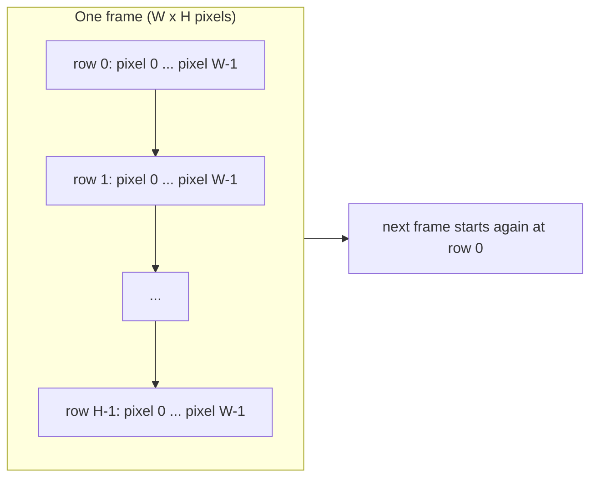

Two markers are enough to recover the 2D structure from the 1D stream. In this design they are carried as side-band
bits next to every pixel (the AXI4-Stream convention, chapter 5):

* **`tuser` = start of frame (SOF)**, high on the first pixel of the frame;
* **`tlast` = end of line (EOL)**, high on the last pixel of each row.

A receiver that knows $W$ can count pixels itself, but these flags make hardware robust: if a pixel is lost, the next
`tlast` or `tuser` resynchronises it. Chapter 6 shows how this design repairs damaged frames.

### 1.3 Colour: RGB, luma and gamma

**RGB** describes a colour as the amounts of three primaries. Displays emit light in these three, so RGB is the natural
format for the last stage. For *analysis* it is often more useful to separate **brightness** (luma, $Y$) from colour.
The standard definition-TV weighting (ITU-R BT.601) is

$$Y = 0.299\,R + 0.587\,G + 0.114\,B$$

reflecting that the eye is most sensitive to green and least to blue. In hardware, multiplication by non-integers is
expensive, so we approximate with integers that sum to a power of two and shift:

$$Y \approx \frac{77\,R + 150\,G + 29\,B}{256} \qquad (77+150+29 = 256)$$

This is exactly what `vc_gray()` in `src/cores/vc_common/vc_video.h` computes. The result is within about one level of the ideal (the weights are off by less than 0.002, and the shift truncates). Dividing by 256 is free (take the upper bits), so the whole luma costs three small multipliers
and two adders.

**Gamma.** Stored RGB values are not proportional to light. They are **gamma-encoded**, roughly
$\text{value} \approx \text{light}^{1/2.2}$, so that the 256 levels are spent where the eye can distinguish steps
(in the darks). Averaging or interpolating gamma-encoded values, as this project does, is a common approximation: it is
not photometrically exact, but it is what almost all consumer video pipelines do and it keeps the arithmetic simple.
Exercise 17.4 asks you to estimate the error.

### 1.4 How a frame sits in memory

In DDR memory a frame is a contiguous array in raster order. The driver uses **three bytes per pixel in the order
B, G, R** (the order OpenCV uses; the hardware pipeline internally carries `{R,G,B}` in a 24-bit word and the DMA stores
it little-endian, which yields B first). The distance in bytes from the start of one row to the next is the
**stride**; here it equals the line length $3W$ because there is no padding.

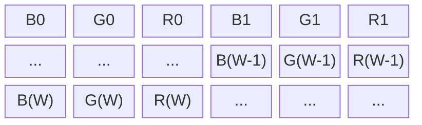

*Row 0 occupies bytes $0 \ldots 3W-1$; pixel $(x,y)$ starts at byte $3(yW + x)$.*

A frame in each of this project's video modes is:

| Mode | Size | Bytes per frame |
|---|---|---|
| 480p | 720 x 480 | 1,036,800 |
| 240p | 1440 x 240 | 1,036,800 |
| XGA | 1024 x 768 | 2,359,296 |
| 720p | 1280 x 720 | 2,764,800 |
| 1080p30 | 1920 x 1080 | 6,220,800 |

---

## 2. Video timing and video modes

### 2.1 Why there is more than the picture

The picture occupies only part of the signal. Historically a cathode-ray tube needed time for the electron beam to fly
back to the left edge after each line (**horizontal blanking**) and back to the top after each frame (**vertical
blanking**), and it needed synchronisation pulses telling it when to do so. Flat panels do not need the flyback time,
but the signalling standards still carry the same structure, so we must reproduce it exactly.

A **video mode** is the complete timing contract: the active size, the blanking intervals, the position and polarity
of the sync pulses, and the pixel clock. Every number below appears in `src/overlay/modes/<mode>.env`.

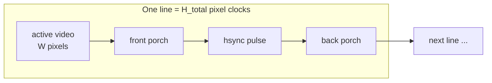

The same structure repeats vertically, counting lines instead of pixels:

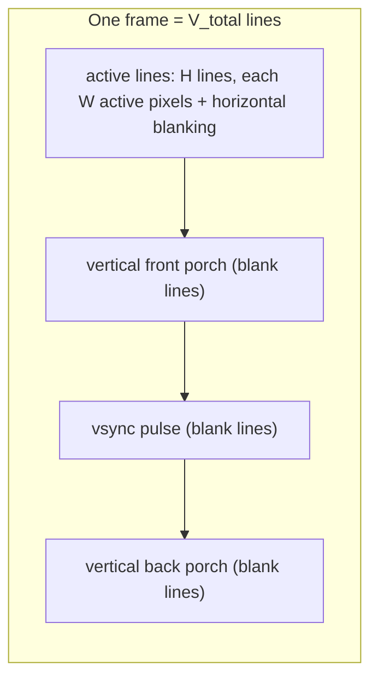

### 2.2 The numbers that define a mode

For a mode with $H_\text{total}$ clocks per line and $V_\text{total}$ lines per frame, the **pixel clock** is

$$f_\text{pixel} = H_\text{total} \cdot V_\text{total} \cdot f_\text{frame}$$

Worked example, 720p60 (CEA-861 mode 4): $1650 \times 750 \times 60 = 74{,}250{,}000$ Hz. Of those 1650 clocks per line,
1280 are active; of the 750 lines, 720 are active. The timing, with horizontal values in pixel clocks and vertical in
lines:

| | active | front porch | sync | back porch | total |
|---|---|---|---|---|---|
| horizontal | 1280 | 110 | 40 | 220 | 1650 |
| vertical | 720 | 5 | 5 | 20 | 750 |

Here are all the modes this project builds. The totals come from the mode files; the derived columns are computed.

| Mode | Active | $H_\text{total}\times V_\text{total}$ | Pixel clock | Frame rate | Line rate | Active fraction | Sync polarity |
|---|---|---|---|---|---|---|---|
| 720p | 1280 x 720 | 1650 x 750 | 74.25 MHz | 60.00 Hz | 45.00 kHz | 74.5 % | (Vivado preset) |
| 480p | 720 x 480 | 858 x 525 | 27.00 MHz | 59.94 Hz | 31.47 kHz | 76.7 % | negative |
| 240p | 1440 x 240 | 1716 x 262 | 27.00 MHz | 60.05 Hz | 15.73 kHz | 76.9 % | negative |
| 1080p30 | 1920 x 1080 | 2200 x 1125 | 74.25 MHz | 30.00 Hz | 33.75 kHz | 83.8 % | positive |
| XGA | 1024 x 768 | 1344 x 806 | 65.00 MHz | 60.00 Hz | 48.36 kHz | 72.6 % | negative |

**Why 59.94 Hz?** Colour NTSC television shifted the 60 Hz field rate by a factor $1000/1001$ to keep the colour
subcarrier from interfering with the sound carrier. The legacy persists in the 27 MHz standard-definition modes: $27\,\text{MHz}/(858 \times 525) = 59.94$ Hz.

### 2.3 The "240p" mode and pixel repetition

Old game consoles (the Nintendo Wii in 240p, for example) generate **240 lines per frame** instead of 480: they
omit the second interlaced field and redraw the same field each time. Over HDMI, a 720-sample line is sent at 27 MHz,
which would be 858 clocks per line. To carry it, the HDMI standard defines **pixel repetition**: each pixel is sent
twice, giving 1440 transmitted pixels and 1716 clocks per line. This project treats the doubled stream as a
1440-pixel-wide picture (`src/overlay/modes/240p.env`), which is the simplest faithful way to capture it.

### 2.4 Progressive and interlaced scanning

A **progressive** mode sends every line of each frame. An **interlaced** mode sends the even lines (one **field**), then
the odd lines (the next field), halving the line rate for a given vertical resolution.

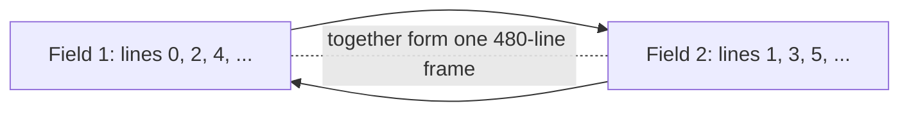

This design processes each field as its own picture of half the height. That works and costs nothing, but it is
visibly different from a true deinterlacer: the filters would see alternating fields, and a vertical filter would
mix lines that belong to different instants. Interlaced input (480i, 1080i) is therefore listed as "shown field by
field" in this project, and has not been tested on the board.

### 2.5 Why mode matters to hardware

Three consequences recur throughout this guide:

1. **The pixel clock sets the data rate** the pipeline must sustain while a line is active, regardless of the longer-term average.
2. **Active size sets memory**: frame buffers, line buffers, and DDR bandwidth all scale with $W \times H$.
3. **Timing is a contract with the display.** A monitor only locks to a mode it recognises, which is why the *output* timing in this design is generated from the same table as the input.

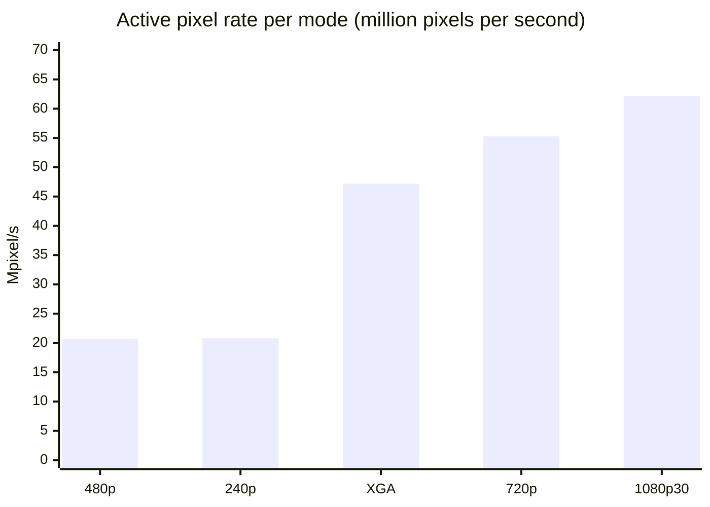

*Active pixels per second = $W \times H \times f_\text{frame}$. The pipeline clock (100 MHz) comfortably exceeds all of these,
which is why one pixel per clock works. 1080p60 would need 124 Mpixel/s and does not fit.*

---

## 3. HDMI and DVI on the wire

### 3.1 Four differential pairs

HDMI's video path is **DVI**'s: three **data** pairs and one **clock** pair, each a differential signal using
**TMDS** (Transition-Minimised Differential Signalling). Each data pair carries one colour channel of 8 bits.

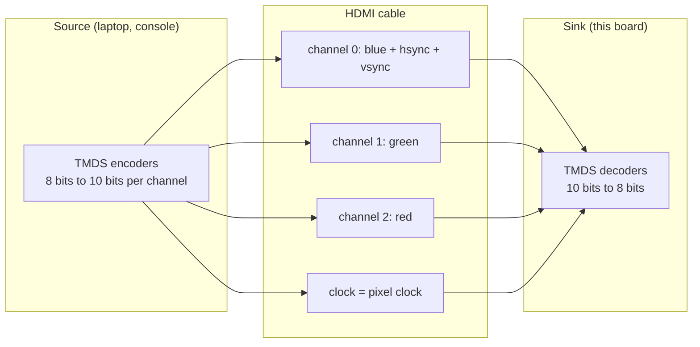

Key facts:

* **Ten bits per pixel per channel.** Each pixel clock, each channel sends one 10-bit symbol. The serial bit rate per
  channel is therefore $10 \times f_\text{pixel}$: 742.5 Mbit/s for 720p60, 270 Mbit/s for 480p, and 1.485 Gbit/s for 1080p60.
* **Transition minimisation.** The encoder chooses between two ways of writing each 8-bit value so that the number of
  signal transitions is small, which reduces electromagnetic emissions.
* **DC balance.** It then optionally inverts the word so that over time the numbers of ones and zeros are equal, keeping
  the average voltage of the line constant (important for AC-coupled links and for the receiver's clock recovery).
* **Control periods.** During blanking the link carries special 10-bit control symbols that include the horizontal and
  vertical sync bits (on the blue channel). The receiver rebuilds the sync signals from them.
* **Data islands (HDMI only).** HDMI uses part of the blanking interval to carry packets: digital **audio**, and
  **InfoFrames** describing the video format. DVI has none of these.

**What this project does with the extras.** The receiver we use (Digilent `dvi2rgb`) decodes video and sync only; it
ignores data islands, so **audio is dropped**, and the transmitter (`rgb2dvi`) writes a DVI-style stream with no data
islands or InfoFrames. Most monitors accept this. It is also why the EDID we give the source is a single 128-byte
block with no HDMI audio capabilities: a source that sees such a sink normally stops sending audio.

### 3.2 EDID: how a source learns what the sink accepts

When a cable is plugged in, the source reads a small table called **EDID** (Extended Display Identification Data) from
the sink over a two-wire **DDC** bus (an I²C link in the cable). The EDID lists the video modes the sink supports. The
source normally picks the preferred mode from it, so *by advertising only one mode we steer the source toward the mode
the loaded bitstream handles.*

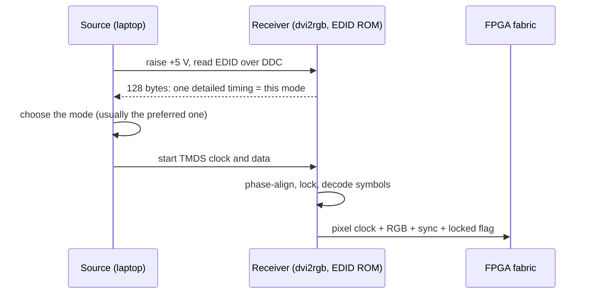

The EDID base block is 128 bytes: a header, vendor and product, basic display parameters, up to four 18-byte **detailed
timing descriptors**, and a checksum chosen so that the sum of all 128 bytes is zero mod 256. The project generates
its EDIDs from the mode files with `src/overlay/edid/gen_edid.py`; the test suite checks the header, the checksum, and that
the descriptor decodes back to the mode's timing and the vertical-rate limits include the mode's refresh rate.

### 3.3 Clock recovery and the clock bands

The receiver gets the pixel clock on the TMDS clock pair, but it needs a bit clock ten times faster to sample the serial
data (in practice five times, because it samples on both edges of a **DDR** clock). It creates it with an **MMCM**
(mixed-mode clock manager), a PLL-based block on the FPGA. An MMCM has a **VCO** (voltage-controlled oscillator) that
must run inside a fixed range; for the Zynq-7000 family at speed grade -1 that range is 600 to 1200 MHz.

The Digilent IP therefore multiplies the pixel clock by $5k$ where $k$ is a *clock band* parameter, giving

$$f_\text{VCO} = 5\,k\,f_\text{pixel}, \qquad 600 \le f_\text{VCO} \le 1200\ \text{MHz}.$$

| Pixel clock | Band $k$ | VCO | Used by |
|---|---|---|---|
| $\ge 120$ MHz | 1 | 600 to 1200 MHz | 1080p60 (not built) |
| 60 to 120 MHz | 2 | 600 to 1200 MHz | 720p (742.5), 1080p30 (742.5), XGA (650) |
| 40 to 60 MHz | 3 | 600 to 900 MHz | (SVGA) |
| 30 to 40 MHz | 4 | 600 to 800 MHz | |
| 25 to 30 MHz | 5 | 625 to 750 MHz | 480p, 240p (675) |

The stock IP offers only bands 1 and 2. This project makes a patched local copy
(`src/overlay/scripts/prepare_ip.py`) that adds bands 3 to 5, so the 27 MHz modes can use band 5. A unit test
(`test_modes.py`) checks that every mode's band keeps the VCO in range. The same rule applies to the transmitter.
Because 27 MHz and 74.25 MHz cannot share a band, **each video mode family needs its own bitstream**.

**Test your understanding:** the 27 MHz output uses band 5. What would the VCO frequency be with band 2? (Answer:
$5 \times 2 \times 27 = 270$ MHz, below the 600 MHz minimum, so the MMCM could not lock.)

---

## 4. System architecture

### 4.1 The platform

The board is a **PYNQ-Z2**, built around a **Xilinx Zynq-7020** *system on chip*. It combines two parts in one package:

* the **PS** (processing system): a dual-core ARM Cortex-A9 running Linux, with the DDR3 memory controller;
* the **PL** (programmable logic): the FPGA fabric where our video hardware lives.

They talk over **AXI** buses. The ARM controls the hardware by reading and writing registers (AXI4-Lite), and the
hardware reads and writes frames in DDR (AXI4 memory-mapped, through the PS's **HP** ports).

### 4.2 The pipeline

```mermaid
flowchart LR
    HIN["HDMI in<br/>3 data + clock"] --> DVI["dvi2rgb<br/>TMDS decode, EDID"]
    DVI --> VIN["v_vid_in_axi4s<br/>video to stream,<br/>clock crossing"]
    TPG["vc_tpg<br/>test pattern"] --> ISEL
    VIN --> ISEL["vc_input_sel<br/>select, normalise,<br/>fallback"]
    ISEL --> SNAP["vc_snapshot<br/>capture one frame"]
    SNAP --> VW["VDMA write"]
    VW --> DDR1[("DDR: live ring<br/>3 frames")]
    DDR1 --> VR["VDMA read"]
    DDR2[("DDR: video memory<br/>2 frames")] --> VM["VDMA read"]
    VR --> MUX["vc_stream_mux<br/>live or video memory"]
    VM --> MUX
    MUX --> TAVG["vc_tavg<br/>temporal average"]
    TAVG --> FILT["vc_filter<br/>8 modes"]
    FILT --> LUT["vc_lut3d<br/>colour grading"]
    LUT --> OVL["vc_overlay<br/>date and time"]
    OVL --> SWP["vc_axis_swap<br/>channel order"]
    SWP --> VOUT["v_axi4s_vid_out<br/>stream to video,<br/>clock crossing"]
    VTC["v_tc<br/>timing generator"] --> VOUT
    VOUT --> RGB["rgb2dvi<br/>TMDS encode"]
    RGB --> HOUT["HDMI out"]
```

Read the diagram left to right. The design makes several deliberate choices:

* **Capture and display are decoupled by memory.** The input is written to a ring of frame buffers in DDR; the output
  reads from that ring. The two sides can run at slightly different frame rates (a source at 59.94 Hz feeding an output
  that generates 60.00 Hz) without any special logic: the reader just sometimes repeats a frame (chapter 7).
* **Processing is on the output side of the buffer.** Filters therefore apply to *everything shown*, whether live video
  or an image the software wrote into video memory, and the same filters can be shown even if the HDMI input is missing.
* **A snapshot is taken before the buffer**, from whichever input is selected, so it records the unprocessed source.
* **Every processing block is bypassable**, and the blocks are independent: any filter, the temporal average, the colour
  grade and the timestamp can be combined.

### 4.3 Clock domains

A **clock domain** is a set of registers driven by the same clock. Moving data between domains needs a **clock-domain
crossing** (CDC), because a signal sampled near a clock edge can become metastable. This design has three domains:

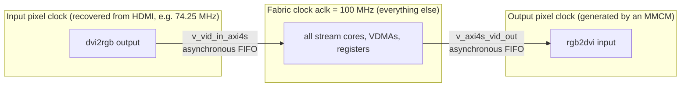

The two crossings are done **only** inside the two Xilinx video-bridge IP blocks, which contain proper asynchronous
FIFOs. Everything between runs on one 100 MHz clock, so our own cores contain no CDC logic at all. This is a standard
discipline: confine crossings to a few well-tested places.

Note the consequence for throughput: the fabric clock must be able to carry the **active** pixel rate. At 100 MHz and one
pixel per clock, any mode with an active pixel rate above about 100 Mpixel/s does not fit (chapter 2.5).

### 4.4 Three kinds of interface

| Interface | Used for | Data | Protocol |
|---|---|---|---|
| **AXI4-Stream** | pixels between cores | 24-bit pixel + SOF + EOL | valid/ready handshake (chapter 5) |
| **AXI4-Lite** | control registers | 32-bit words, addressed | simple read/write, one at a time |
| **AXI4 memory-mapped** | frames to and from DDR | 64-bit bursts | address + burst channels |

The ARM sees every block as a window of registers at a fixed address. The map is in `docs/register_map.md`:

| Block | Base address | Role |
|---|---|---|
| `vdma_live` | `0x4000_0000` | live frame ring |
| `vdma_vmem` | `0x4001_0000` | video memory reader |
| `rtc` | `0x4002_0000` | date and time clock |
| `isel` | `0x4003_0000` | input select |
| `vmux` | `0x4004_0000` | live / video memory select |
| `filt` | `0x4005_0000` | spatial filters |
| `ovl` | `0x4006_0000` | timestamp |
| `snap` | `0x4007_0000` | snapshot |
| `intc` | `0x4008_0000` | interrupt controller |
| `tavg` | `0x4009_0000` | temporal average |
| `lut` | `0x400A_0000` | colour grading |

---

## 5. Streaming video and back-pressure

### 5.1 The valid/ready handshake

Between two cores the pixels travel on an **AXI4-Stream** link. The producer drives `tvalid` ("this data is real") and
the consumer drives `tready` ("I can take it"). A transfer happens in a clock cycle when **both are high**.

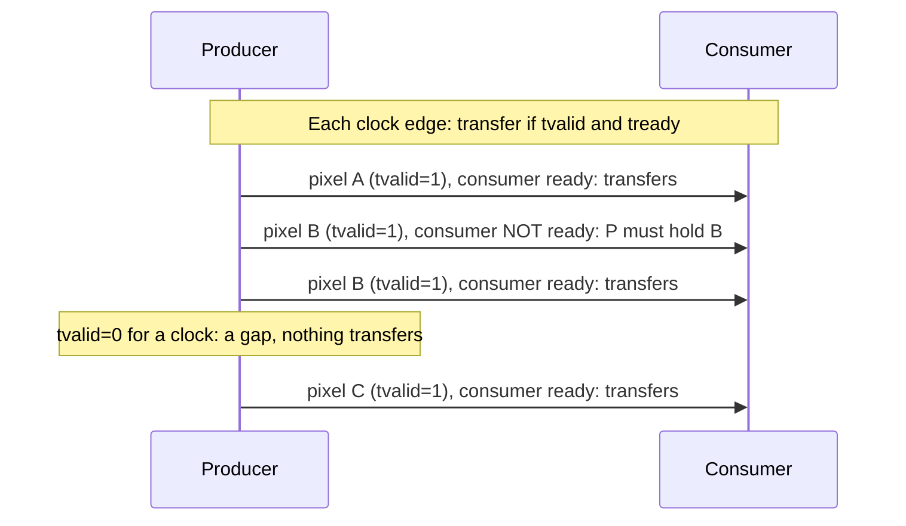

Why this matters: any block can stall for a while (a DMA waits for memory, a block does a burst write at the end of a
line, the output display is not yet ready for the next line). `tready` propagates that stall **backwards** through
the whole chain. We call this **back-pressure**. The rules every stage in this design obeys:

1. A producer that has asserted `tvalid` must keep the same data until the transfer happens.
2. A consumer may deassert `tready` at any time.
3. A core with internal pipeline stages must **stall all stages together** when its output is blocked, otherwise a pixel would be overwritten before it is consumed.

The colour-grading core (chapter 11) is a good model: a single signal `adv = m_axis_tready || !valid_last` decides
whether the entire 14-stage pipeline moves or holds.

### 5.2 Frame markers

The stream carries `tuser` (SOF) and `tlast` (EOL) along with the pixel, so a stage that adds latency must delay the
markers by the same amount as the data. A very common bug is to delay the pixel but forget a marker. The testbenches
in this repository check `tuser` and `tlast` explicitly at every output pixel.

### 5.3 Throughput and latency

* **Throughput**: all cores here accept one pixel per clock when not stalled.
* **Latency**: each stage of processing delays the output. The 3x3 filters need one line plus one pixel before the
  first output, because the centre pixel's neighbours below and to the right have not arrived yet (chapter 8). The
  colour-grading pipeline is 14 clocks deep. Latency is harmless in a stream as long as the markers stay aligned.

---

## 6. Taming the input

Real inputs are untidy: an HDMI cable can be unplugged, a source can change mode mid-frame, a frame can be short or
long, and the first pixel after a glitch may not be a frame start. If the next stages (the DMA especially) see a
malformed frame, they can lose synchronisation permanently. A small block, `vc_input_sel`, guarantees that **everything
downstream sees only complete $W \times H$ frames**.

### 6.1 The frame normaliser

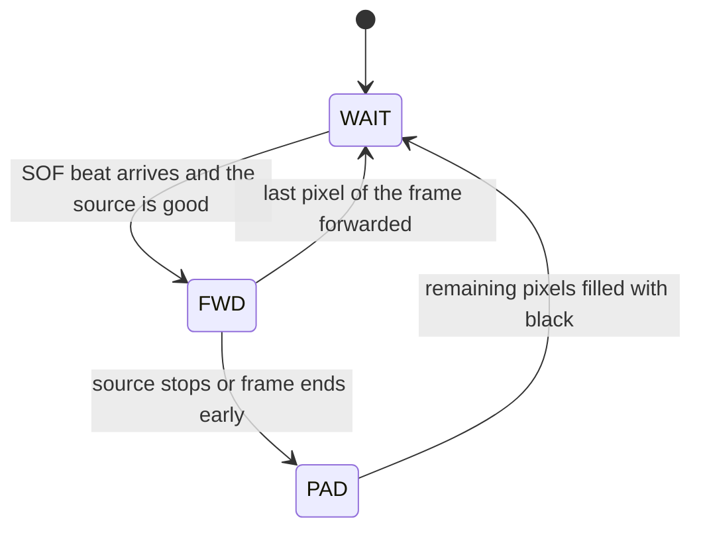

* In **WAIT** it discards pixels until a valid frame start, so a late or garbled start never reaches the DMA.
* In **FWD** it forwards pixels and counts $x$ and $y$. It regenerates `tlast` and `tuser` from its own counters, so the
  output markers are always consistent with the frame size.
* In **PAD** (after an aborted or short frame) it emits black pixels until the frame is complete, and sets a sticky flag
  that software can read.

It also **measures** the incoming frame size and counts frames, and calls the input "good" only when the link is
locked, the measured size equals the mode's size, and frames keep arriving. A wrong-sized or missing signal is
therefore detected rather than propagated.

### 6.2 Fallback to a test pattern

If HDMI has not been good for 5 seconds the block switches to an internal test pattern; it returns to HDMI after the
signal has been good for 1 second. The hysteresis (different delays in each direction) prevents flicker when a
marginal signal comes and goes. The same state machine is also used when software explicitly selects the pattern.

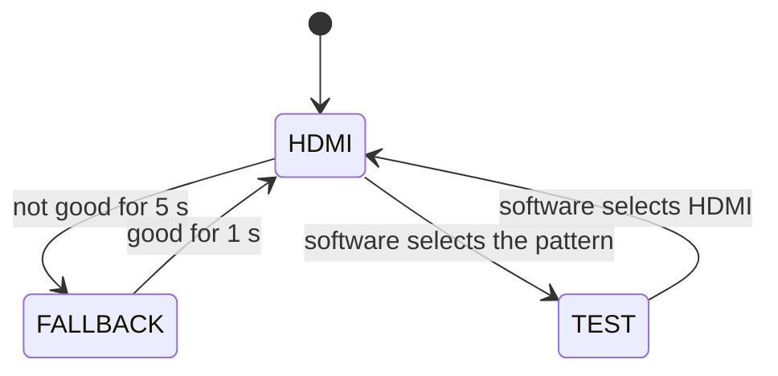

The switch is made only on a **frame boundary**, so a frame never contains pixels from two sources.

### 6.3 The test pattern generator

`vc_tpg` generates 8 colour bars (white, yellow, cyan, green, magenta, red, blue, black) and a $64 \times 64$ box that
moves 8 pixels right and 4 pixels down each frame, bouncing off the edges. Two design points:

* The pattern is a **pure function of the frame number**, so a testbench can predict every pixel.
* A moving object is a built-in **liveness indicator**: if the box stops, the pipeline has stalled somewhere.

A timing lesson from this block: the original bar selector computed `x / BAR_W` in the data path. A division by a
non-power-of-two constant synthesises to a chain of adders, and in one video mode the path from the pixel counter to
the snapshot core failed timing by 0.07 ns. The fix replaced the division with a small counter that increments along
with $x$. When a long combinational path is arithmetic, ask whether a running counter can replace it.

---

## 7. Frame buffers and DDR bandwidth

### 7.1 Why frames go through memory

Three jobs need a whole frame to be stored:

* **Rate decoupling.** The input and output run from different clocks (chapter 4.3). Storage between them absorbs the difference.
* **Snapshots and video memory**, where software reads or writes a complete image.
* **Temporal processing**, which compares the current frame with earlier ones.

A frame is millions of bytes, too big for the FPGA's block RAM, so it lives in the board's DDR3 memory. The tool that
moves pixels between stream and memory is a **VDMA** (video direct memory access) engine.

### 7.2 A ring of three buffers

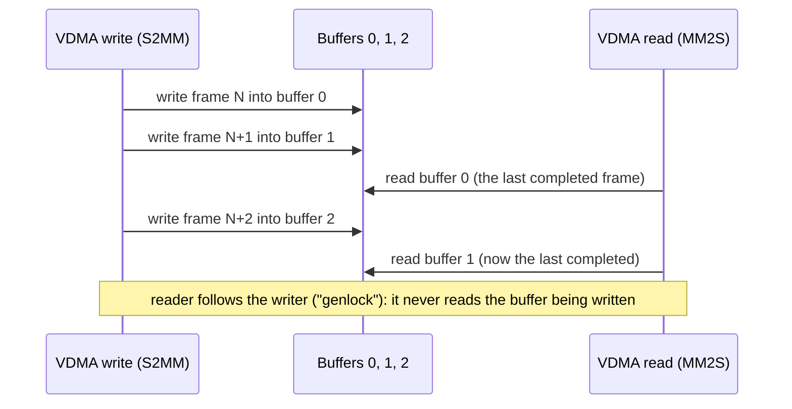

With **three** buffers the writer always has a free buffer, and the reader always has a complete one. The VDMA is
configured with the writer as **master** and the reader as **slave**: the reader's frame pointer follows the writer's,
so it shows the most recently completed frame. If the output runs faster than the input, the reader repeats a frame;
if it runs slower, a frame is dropped. Either way the picture is never torn.

A second VDMA with **two** buffers and a *park* pointer holds the **video memory**: software writes a new image into
the hidden buffer, then switches the park pointer to it. The switch takes effect at a frame boundary, so the change
is clean. This is **double buffering**.

### 7.3 The bandwidth budget

Bandwidth is the amount of data moved per second. For one stream of frames:

$$B = W \cdot H \cdot \text{bytes per pixel} \cdot f_\text{frame}$$

Per mode, with 3 bytes per pixel:

| Mode | One frame | One stream | Live path (write + read) |
|---|---|---|---|
| 480p | 1.04 MB | 62.1 MB/s | 124 MB/s |
| 240p | 1.04 MB | 62.3 MB/s | 125 MB/s |
| XGA | 2.36 MB | 141.6 MB/s | 283 MB/s |
| 720p | 2.76 MB | 165.9 MB/s | 332 MB/s |
| 1080p30 | 6.22 MB | 186.6 MB/s | 373 MB/s |
| 1080p60 | 6.22 MB | 373 MB/s | 746 MB/s |

The board has DDR3 with a theoretical peak around 2 GB/s that is shared by the CPU and every DMA. Real throughput is
lower. Each of the PS's high-performance ports is a 64-bit AXI bus that, at 100 MHz, can carry at most about 800 MB/s. For 1080p60
the live path alone nearly fills one port, and the temporal average (below) adds as much again. This is the real
reason 1080p60 is a different design problem, not just a faster clock.

### 7.4 Sizing the buffers

The buffers are allocated from **CMA**, Linux's contiguous memory pool (128 MB on this image). The DMA needs physically
contiguous memory, and the driver maps it so Python can read and write it. The allocation per start is 3 live, 2
video-memory and 1 snapshot frame, plus the temporal-average history. At 1080p30 that is $6 \times 6.2 = 37$ MB for the
frames. A 16-frame average history would take 37 MB more, but only about 68 MB of the pool is free after boot, and every bitstream
load leaks a few MB. The driver therefore reserves 8 frames of history (21 MB) when a frame is larger than 3 MB, and 16 otherwise.

---

## 8. Spatial filters

### 8.1 Point operations

A **point operation** computes each output pixel from the single input pixel at the same place, $O[y][x] = f(I[y][x])$.
They need no memory and no neighbours, so they can be written as pure combinational logic.

| Mode | Operation |
|---|---|
| passthrough | $O = I$ |
| invert | $O = 255 - I$ per channel (bitwise NOT) |
| grayscale | $O_R=O_G=O_B=Y$, $Y=(77R+150G+29B)\gg 8$ |
| threshold | $O = 255$ if $Y > t$ else $0$ for all three channels |

### 8.2 Neighbourhood operations and convolution

A **neighbourhood operation** computes each output pixel from a small window around it. The most important kind is
**convolution** with a small **kernel** (a grid of weights): multiply each pixel in the window by the matching weight and sum.

For a $3 \times 3$ kernel $K$:

$$O[y][x] = \sum_{i=-1}^{1}\sum_{j=-1}^{1} K[i][j]\; I[y+i][x+j]$$

This design implements three kernels in one datapath.

**Blur** (a Gaussian-like low-pass filter, which smooths by averaging):

$$K_\text{blur} = \frac{1}{16}\begin{bmatrix}1&2&1\\2&4&2\\1&2&1\end{bmatrix}$$

The weights sum to 16, so the output has the same overall brightness; dividing by 16 is a right shift by 4, and adding 8 first rounds instead of truncating.

**Sharpen** (a high-boost filter that emphasises edges):

$$K_\text{sharpen} = \begin{bmatrix}0&-1&0\\-1&5&-1\\0&-1&0\end{bmatrix}$$

The weights sum to 1 (flat areas are unchanged), but the negative neighbours subtract the local average, so differences
are exaggerated. The result can leave the range 0 to 255, so it is **clamped**.

**Sobel edge detector.** Edges are places where brightness changes quickly. Two kernels estimate the horizontal and
vertical derivatives of the luma image:

$$G_x = \begin{bmatrix}-1&0&1\\-2&0&2\\-1&0&1\end{bmatrix} * Y,\qquad
G_y = \begin{bmatrix}-1&-2&-1\\0&0&0\\1&2&1\end{bmatrix} * Y$$

The exact gradient magnitude is $\sqrt{G_x^2+G_y^2}$. A square root and two squarings are costly in hardware, so the
design uses the common approximation $|G_x|+|G_y|$, which is within about 41 % of the true value and has the same
zero-crossings, then clamps to 255. For an edge detector that is entirely acceptable.

### 8.3 The streaming window and line buffers

A $3 \times 3$ window needs three rows at once, but the pixels arrive one at a time in raster order. The solution is to
remember the previous two rows in **line buffers** (small block RAMs) and to hold the 9 window pixels in registers.

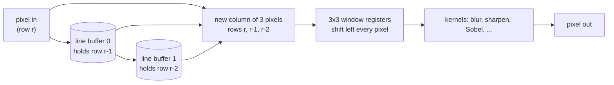

Each clock a new column enters on the right, the window shifts left, and each line buffer is read and written at the
same address (a two-port RAM), so each stores exactly one row. Memory cost is two rows of $W$ pixels, independent of $H$:
at 1920 pixels and 24 bits that is only 11.5 kB. Consequences:

* **Latency of one line plus one pixel.** The centre pixel of the window is one row and one column behind the input. To
  keep the interface simple, *every* mode, even passthrough, reads the window centre, so all modes have identical delay.
  `vc_filter` therefore runs $(H+1)(W+1)$ iterations per frame (one extra row and column flush the window).
* **Borders.** At the frame edge some window pixels do not exist. The design **replicates the nearest pixel**: at the top
  row, "row $-1$" is taken from row 0, and similarly at the other edges. Other common choices are zero padding and
  mirroring; they produce different, and sometimes visible, edge artefacts.
* **One pixel per clock.** The loop is written so that the HLS tool can start a new iteration every clock cycle
  (an *initiation interval* of 1), the key property that lets a frame be processed at the pixel rate.

### 8.4 Fixed-point arithmetic

FPGAs are efficient with integers and expensive with floating point. **Fixed-point** keeps fractional values in integers
by agreeing on a scale. The luma weights $0.299, 0.587, 0.114$ become $77/256, 150/256, 29/256$: the denominator is a
power of two, so division is a shift. Rules of thumb used throughout the code:

* choose the **width** from the worst case (each Sobel gradient lies within $\pm 4\cdot 255 = \pm 1020$, so it needs 11 signed bits; the code allocates 14 for margin, and 16 for the summed magnitude);
* **round** before shifting when a systematic bias matters (the blur adds 8 before $\gg 4$);
* **clamp** when an operation can leave the range of the output type;
* keep **extra precision** until the last operation (the 3D colour grade keeps 8 fractional bits through all three interpolations and rounds once).

---

## 9. Noise from a shift register

The `noise` mode adds the grainy "snow" of a worn VCR tape. It needs a source of pseudo-random numbers that is cheap
and fast: a **linear-feedback shift register** (LFSR).

### 9.1 LFSR basics

An LFSR is a shift register whose update is a shift plus exclusive-ors with selected bits (the *taps*). Starting from
any non-zero state, an LFSR with a suitably chosen tap polynomial cycles through every non-zero state before
repeating: its period is $2^n - 1$ for $n$ bits. Here $n = 32$ and the tap mask is `0x80200003`
(the polynomial $x^{32}+x^{22}+x^2+x+1$, a known maximal-length choice), so the sequence repeats only after about four
billion steps, far longer than a viewer could notice. This is the *Galois* form: shift right, and if the bit that fell
out was 1, exclusive-or the tap mask into the register.

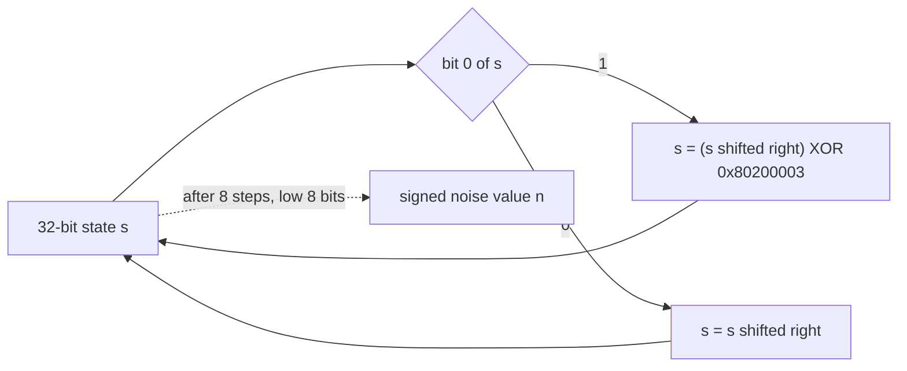

Hardware gets one new bit per clock, but we want an **8-bit** random value for every pixel. The code advances the LFSR
**eight steps per pixel** (a loop of eight shift-and-XOR operations that the tool turns into combinational logic), and
uses the low 8 bits as a signed number from $-128$ to $127$.

### 9.2 Scaling the noise

The user's **noise strength** $a$ (0 to 255) scales the random value $n$:

$$\Delta = \frac{n \cdot a}{256}\quad(\text{an arithmetic shift of the product by 8})$$

so $a = 255$ gives changes of up to about $\pm 127$ levels and $a = 0$ gives none. $\Delta$ is added to all three
channels, so the grain is **grey** (luminance noise) rather than coloured, which is what tape noise looks like. The
result is clamped to the 0..255 range.

Two design decisions are worth noting:

* The LFSR state is **never reset** after power-up, so the pattern is different every frame.
* The LFSR advances **once per output pixel in every filter mode**, not only in noise mode. That makes the noise
  sequence depend only on how many pixels have been output, which makes the testbench deterministic: the golden model
  steps the same LFSR the same number of times regardless of which mode was selected.

---

## 10. Temporal filtering

Spatial filters combine neighbouring pixels in one frame. **Temporal** filters combine the *same* pixel across time.
For a static scene, averaging $N$ frames reduces independent random noise: the signal adds coherently, the noise
adds in power, so the noise standard deviation falls by $\sqrt{N}$ (averaging 16 frames improves the signal-to-noise
ratio by a factor of four, 12 dB). For moving content the cost is blur along the motion path, the temporal analogue of
a spatial blur.

### 10.1 The naive method and its problem

The direct moving average of the last $N$ frames is

$$\bar{Y}[t] = \frac{1}{N}\sum_{k=0}^{N-1} Y[t-k].$$

Computing this needs all $N$ frames each time, so the memory traffic grows linearly with $N$: $N$ reads per output
pixel. At 720p60, brightness only, one history frame costs about 55 MB/s, so beyond roughly 14 frames the DDR cannot keep up.

### 10.2 The running sum

Subtract the frame that just left the window and add the one that entered:

$$S[t] = S[t-1] + Y[t] - Y[t-N],\qquad \bar{Y}[t] = S[t]/N.$$

Per pixel, the hardware does two reads (the stored sum $S$ and the old frame $Y[t-N]$) and two writes (the new sum and
the new frame $Y[t]$), **for any $N$**. The price is that it must remember the last $N$ frames to subtract the oldest
one, so the history still occupies $N$ frames of memory, but only one frame of history is *read* per output frame.

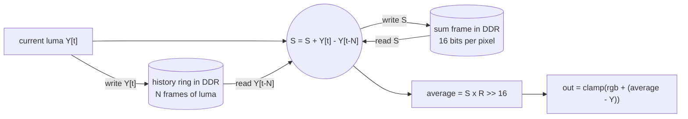

Design details in `src/cores/vc_tavg/vc_tavg.h`:

* **Brightness only.** It averages the *luma* and applies the change to all three channels, $O = \text{clamp}(\text{RGB} + (\bar{Y} - Y))$. That preserves colour, costs one byte per pixel of history instead of three, and avoids colour smearing.
* **Exactness.** Everything is integer, so there is no drift: after a billion frames the sum is still exactly the sum of the last $N$ values. The sum is stored in 16 bits, which holds up to $255 \times 255 = 65025$, so $N$ can be as large as 255.
* **Division by the window length** is a multiplication by a stored reciprocal $R = \text{round}(65536/c)$, where $c$ is the number of frames currently in the window ($c = N$ once it is full), followed by a shift: $\bar{Y} = (S \cdot R + 32768) \gg 16$. Hardware dividers are slow; multipliers are cheap.
* **Warm-up.** The first frames after the filter starts have fewer than $N$ predecessors, so the average uses what exists (1, 2, 3, ... frames). The first output equals the input.
* **Memory traffic**: $1+2+2+1 = 6$ bytes per pixel per frame, about 330 MB/s at 720p60. This is why the temporal average is the heaviest consumer of DDR bandwidth.

A bug worth knowing about: during co-simulation (chapter 14) the first pixel of the pass-through path came out wrong. The
HLS-generated hardware read the frame-start beat and used it in the very next cycle, before the register that held it had
settled. The C simulation could not show this, because C executes sequentially with no notion of a clock. Only the RTL
simulation exposed it. The cure was to isolate that read in a function the tool is forbidden to inline, forcing a
register boundary. The lesson: **simulate the hardware you will build, not just the algorithm.**

---

## 11. Colour grading with a 3D look-up table

### 11.1 From curves to cubes

**Colour grading** changes the look of an image: warmer, more contrasty, faded, a "film look". A **look-up table**
(LUT) is the standard tool: store the answer for each possible input and read it back instead of computing it.

* A **1D LUT** has one table per channel, $R' = T_R[R]$, $G' = T_G[G]$, $B' = T_B[B]$: 256 entries each. It can do
  brightness, contrast and gamma curves. It *cannot* change a colour depending on the other channels, so it cannot
  make a sepia tone from a grey, or push only the blues toward teal.
* A **3D LUT** maps the whole colour: $(R',G',B') = L[R][G][B]$. It can do any colour-to-colour transform, including
  hue shifts, selective saturation, and cross-channel effects. That is why every grading tool exchanges them.

The catch is size. A full table for 8-bit RGB has $256^3 = 16.7$ million entries of 3 bytes, about 50 MB. The standard
solution, used by every grading tool, is to store only a coarse grid of **nodes** (typically 17, 33 or 65 per axis) and
**interpolate** between them.

### 11.2 The cube

This design stores a $17 \times 17 \times 17$ cube: $17^3 = 4913$ nodes, each holding a 24-bit output colour. Node $k$
on an axis stands for the input level $k \cdot 255/16$. Think of the RGB colour space as a unit cube; the table samples it
on a regular lattice.

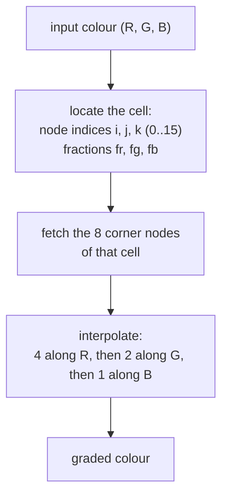

### 11.3 Trilinear interpolation

Inside a cell, the output is a weighted average of its eight corners, weighted by how close the input is to each
corner. With fractional position $(f_r, f_g, f_b) \in [0,1)^3$ within the cell:

$$\text{out} = \sum_{a,b,c\in\{0,1\}} w_a(f_r)\,w_b(f_g)\,w_c(f_b)\; L[i+a][j+b][k+c]
\quad\text{where } w_0(f)=1-f,\ w_1(f)=f.$$

That is $\text{lerp}(a, b, f) = a + (b-a)f$ applied seven times: four times along R (one for each pair of corners that
differ only in R), then two along G, then one along B. The order does not matter mathematically.

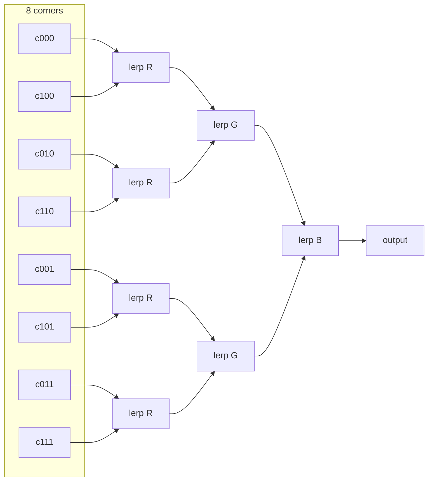

An alternative, **tetrahedral interpolation**, splits the cell into six tetrahedra and uses only four corners. It is
cheaper and many professional tools use it, but it needs a sort of the three fractions to choose the tetrahedron. We
chose trilinear for clarity and because the parity-bank memory trick below makes all eight reads free.

### 11.4 Locating the cell with a shift

For an 8-bit channel value $v$ we need the node index and the fraction. Exactly, $16v/255 = i + f$, which involves a
division by 255. Instead use the identity that $255 \times 257 = 65535$: multiplying by 257 turns $v$ into a 16-bit
number $p = 257\,v$ that spans the full range $0 \ldots 65535$. A 17-node axis has 16 cells, each $4096$ units of $p$ wide, so

$$i = p \gg 12 = v[7{:}4], \qquad f = (p \gg 4)\ \&\ 255 = \{v[3{:}0],\,v[7{:}4]\}.$$

Both are just bit selections; no multiplier or divider. At $v = 255$ the code gets $i=15, f=255$, i.e. 255/256 of the way
to node 16, which is within a fraction of a level of the exact answer.

### 11.5 Memory: eight corners in one clock

Interpolation needs the 8 corners of the cell every clock. A single memory has one or two read ports, so reading 8
words would take 4 to 8 clocks. We could store 8 copies of the table (about 8x the block RAM), but there is a better way.

Observe: the eight corners of any cell have coordinates $(i+a, j+b, k+c)$ with $a,b,c\in\{0,1\}$. Along each axis one
coordinate is even and the other is odd, so **the eight corners always have eight different parity patterns**
$(\text{parity of } i, j, k)$. Store the nodes in eight **banks**, one per parity pattern. Any cell then reads exactly one
word from each bank, simultaneously, and the total storage is just one copy of the cube.

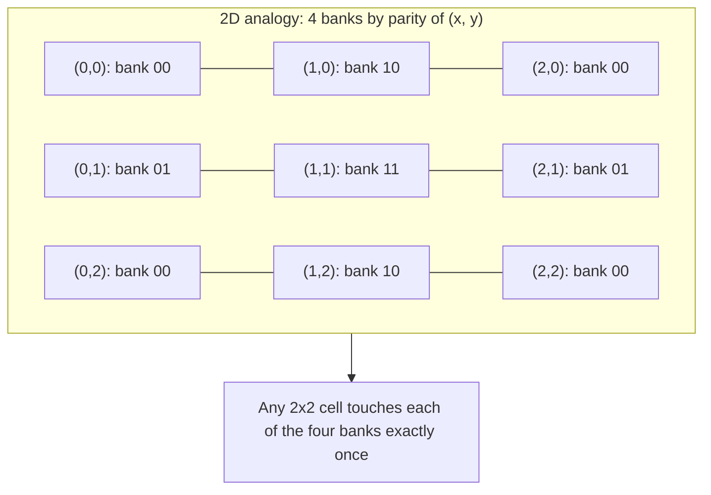

In the real core, node $(r,g,b)$ goes to bank $\{r_0, g_0, b_0\}$ at address
$(r\gg1) + 9\,(g\gg1) + 81\,(b\gg1)$. Even coordinates run $0,2,\ldots,16$ (9 values), odd ones $1,3,\ldots,15$ (8 values),
so each bank holds at most $9^3 = 729$ words, and eight 1024-word block RAMs hold the whole cube. Per pixel, the
core computes the eight addresses, reads them in parallel, and then sorts the eight outputs into corner order using
the parities (a small multiplexer).

### 11.6 The pipeline

```mermaid
flowchart LR
    s0["0 capture"] --> s1["1 addresses"] --> s2["2 bank read"] --> s3["3 corners"]
    s3 --> s4["4 R: differences"] --> s5["5 R: multiply-add"]
    s5 --> s6["6 G: differences"] --> s7["7 G: multiply-add"]
    s7 --> s8["8 B: differences"] --> s9["9 B: multiply-add"]
    s9 --> s10["10 round"] --> s11["11 blend: difference"] --> s12["12 blend: scale"] --> s13["13 add and clamp"]
```

The pipeline is 14 stages, which means 14 clock cycles of latency. All stages advance together under the back-pressure
rule from chapter 5. Each interpolation is split into a **difference** stage and a **multiply-add** stage. The first
version put the subtraction and the multiplication in one stage, and the 480p build missed timing by 0.1 ns; after the
split the worst setup slack was +0.55 ns. The general principle: *register between an adder and a multiplier.*

Fixed-point details: the first interpolation keeps 8 fractional bits ($a\cdot256 + (b-a)f$, 16 bits); the second and third
shift right by 8 to stay at 16 bits; one final rounding $(x+128)\gg8$ gives 8 bits. Rounding once at the end keeps the
error below one level.

### 11.7 Strength

A grade is rarely wanted at full force, so a **strength** $s \in [0,256]$ blends between the original $o$ and the graded
colour $g$:

$$\text{out} = \text{clamp}\!\left(o + \frac{(g - o)\,s + 128}{256}\right)$$

$s=256$ gives exactly $g$; $s=0$ gives exactly $o$, so disabling the grade (strength forced to zero) leaves the pixel
untouched. Enable and strength are sampled on the first pixel of a frame, so a change never appears halfway down a picture.

### 11.8 Making and sharing looks

A look is a $17^3$ array. The driver builds the built-in looks from formulas (`src/drivers/vidcap/lut.py`): for each node,
convert $(r,g,b)$ to $[0,1]$, apply a function, and quantise. Two examples:

* **Sepia**: take the luma $y$ and map it to a warm brown: $(1.07y+0.03,\ 0.94y+0.01,\ 0.74y)$.
* **Teal and orange**: weight the shadows, mid-tones and highlights by the luma, push the shadows toward blue-green and the highlights toward orange, then raise the saturation.

Any `.cube` file can be loaded. The format is plain text, red varying fastest:

```
TITLE "my look"
LUT_3D_SIZE 17
0.000000 0.000000 0.000000      # (r=0,  g=0,  b=0)
0.062745 0.000000 0.000000      # (r=1,  g=0,  b=0)
...                             # 4913 lines in all
```

A file with another size is **resampled** to 17 by interpolation; a 1D file is applied to each channel independently.
After loading, the driver verifies the load: the hardware counts the words written and sums them, and the driver
compares both with what it expected.

### 11.9 Verifying it

The strongest tool here is a **bit-exact reference model**. `apply_lut()` in `lut.py` performs the same integer arithmetic
as the hardware. The testbench `tb_vc_lut3d.v` loads a random table (so every bank and every address is exercised),
streams 640 pixels with random stalls on both sides, and compares every output pixel with the vectors the Python model
produced. On the board, `hw_smoke.py` shows known colours from video memory and reads back the first pixel before and after
the table (the `PROBE` registers), comparing with the same model. When the pipeline was restructured the testbench caught
a signed/unsigned slip immediately: a signed product mixed with an unsigned sum was zero-extended instead of
sign-extended, making results wrong by a few levels whenever a difference was negative.

---

## 12. Text on video and a hardware clock

### 12.1 Drawing text in a stream

To draw text you need, at each pixel position, to know whether it lies on a glyph. The overlay core
(`vc_overlay`) works in the pixel stream: it counts $x$ and $y$, and when the position is inside the text box it
looks up one bit of a **bitmap font** (generated from DejaVu Sans Mono by `gen_font.py` and compiled into the core as a constant table). If the bit
is 1 it substitutes the text colour, otherwise (optionally) a background colour. **Scale** repeats each font pixel
$s \times s$ times. Everything configurable is sampled once per frame so the text never changes halfway down.

### 12.2 A real-time clock in logic

The characters come from `vc_rtc`, a calendar counter. A cycle counter reaches the **cycles-per-second** value
(a register, default 100 million) to produce a 1 Hz tick, which increments seconds, minutes, hours, days, months, years
and centuries, all in decimal digits so they map directly to characters. The interesting part is calendar arithmetic:

$$\text{days in February} = \begin{cases}29 & \text{year divisible by 4, except centuries not divisible by 400}\\ 28 & \text{otherwise}\end{cases}$$

(1900 was not a leap year; 2000 was.) The testbench checks 1900, 2000, month and year rollovers, rejected invalid dates,
and the trim register. Because crystal oscillators drift, software can adjust the cycles-per-second register to
correct the error, and the driver provides a drift measurement against the board's own clock. The hardware clock keeps
plain wall-clock time and software sets it from Linux at start-up, using the time zone of your choice.

---

## 13. Getting the picture out

```mermaid
flowchart LR
    S["pixel stream<br/>(100 MHz)"] --> V["v_axi4s_vid_out<br/>FIFO and re-timing"]
    T["v_tc<br/>timing generator<br/>(active, sync, blanking)"] --> V
    V -->|"RGB + hsync + vsync + data enable<br/>(pixel clock)"| X["rgb2dvi<br/>serialise and drive TMDS"]
    X --> H["HDMI connector"]
    P["clock wizard (MMCM)<br/>generates the pixel clock"] --> V
    P --> X
```

* **Timing generator.** `v_tc` is configured as a fixed generator (no registers): it counts pixels and lines and produces
  the sync, blanking and active-video signals for the chosen mode. For 720p there is a preset; for the others
  the block design sets the horizontal and vertical totals, sync positions and polarities from the mode file (`GEN_*`
  parameters).
* **Stream to video.** `v_axi4s_vid_out` pulls pixels from the stream when the timing generator says "active" and
  inserts them. Its FIFO is the output clock crossing. Its important behaviour: it needs the stream to be *ahead* of the
  timing generator. If the stream is late it underflows and the picture breaks; the frame buffer (chapter 7) is what
  guarantees the data is ready.
* **Pixel clock.** An MMCM generates the exact pixel clock for the mode (74.25 MHz, 27.0 MHz, 65.0 MHz). It is
  independent of the input clock, so the output frame rate is whatever the mode says, while the input frame rate is
  whatever the source delivers.
* **Channel order.** The pipeline carries pixels as `{R,G,B}`, but the Digilent encoder takes `{R,B,G}` (the order of
  its TMDS channels). A pure-wiring core, `vc_axis_swap`, exchanges the lower two bytes just before the output block.
  The receiver does the reverse at the input. This is a good example of how a tiny convention mismatch costs a
  whole debugging session: the colour bars read in the wrong order until the swap is right.

---

## 14. Building and verifying hardware

### 14.1 Two ways to describe hardware

| | **RTL (Verilog)** | **HLS (C++)** |
|---|---|---|
| You describe | registers, wires, state machines, per clock | an algorithm; the tool schedules it |
| Control | exact: you decide every register | the tool decides; you steer with pragmas |
| Good for | protocol logic, state machines, clock-tight datapaths | image kernels with regular loops |
| Used here for | input select, stream mux, test pattern, RTC, channel swap, colour-grading table | spatial filters, snapshot, overlay, temporal average |

HLS code for a pixel pipeline is a loop with `#pragma HLS PIPELINE II=1`: "start a new iteration every clock".
The tool builds the registers and the control; but it also decides how values are held between cycles, which is
where the stale-data bug of chapter 10 hid.

### 14.2 The flow

```mermaid
flowchart LR
    CPP["C++ cores (HLS)"] -->|"C simulation"| CS["golden-model check"]
    CPP -->|"synthesis"| RTL1["generated RTL"]
    RTL1 -->|"C/RTL co-simulation"| CO["same testbench<br/>on the real hardware design"]
    RTL1 -->|"package"| IP["IP"]
    V["Verilog cores"] -->|"xsim testbench"| TB["self-checking test"]
    IP --> BD["Vivado block design (Tcl)"]
    V --> BD
    VENDOR["vendor IP: DMA, video bridges, HDMI"] --> BD
    BD -->|"synthesis"| SYN["netlist"]
    SYN -->|"place and route"| IMPL["placed design"]
    IMPL -->|"timing check"| T{"slack >= 0?"}
    T -->|"yes"| BIT["bitstream"]
    T -->|"no"| FIX["fix the design"]
    BIT --> BOARD["load on the board and test"]
```

Everything is generated from text. The block design is a Tcl script (`vidcap_bd.tcl`), so a reviewer can read what is
connected to what, and the build can be repeated by anyone. `workspace/` holds only generated files and is not in git.

### 14.3 Static timing analysis

A design is correct only if every signal reaches every register before the next clock edge. The tool checks all paths:

$$\text{setup slack} = T_\text{clock} - (t_\text{clk-to-q} + t_\text{logic} + t_\text{routing} + t_\text{setup}) - \text{uncertainty}$$

With a 100 MHz clock, $T = 10$ ns. A negative **WNS** (worst negative slack) means a path is too slow. **WHS** is the
hold equivalent (data must not change *too soon* after the edge). The build here refuses to produce a bitstream
unless both are non-negative.

Worked results from this project:

| Mode | LUTs | BRAM tiles | DSPs | Setup slack (ns) | Hold slack (ns) |
|---|---|---|---|---|---|
| 720p | 15,786 (30 %) | 40.5 (29 %) | 48 (22 %) | +0.835 | +0.027 |
| 480p | 15,759 (30 %) | 34.5 (25 %) | 50 (23 %) | +0.837 | +0.016 |
| 240p | 15,775 (30 %) | 41.5 (30 %) | 50 (23 %) | +0.554 | +0.020 |
| XGA | 15,711 (30 %) | 34.5 (25 %) | 42 (19 %) | +0.579 | +0.004 |
| 1080p30 | 15,874 (30 %) | 41.5 (30 %) | 46 (21 %) | +0.738 | +0.021 |

Real failures from this project, and what they teach:

1. **A long combinational chain.** The first colour-grading blend (subtract, multiply, add, clamp in one stage) failed by 1.2 ns. *Pipelining fix: one operation per stage.*
2. **Subtract then multiply.** A near-miss of 0.1 ns on the interpolator. *Register between an adder and a multiplier.*
3. **A division in a data path** in the test pattern. *Replace with a counter.*
4. **A wrong constraint.** The input-clock constraint was written for 120 MHz and used for a 27 MHz mode. Vivado's DRC then reported that the receiver clock generator's VCO was at 3 GHz, far outside 600 to 1200 MHz. *Constraints are part of the design; derive them from the mode.*
5. **Counter widths.** The test pattern's row counter was 10 bits, fine up to 1023 lines, wrong for 1080 lines. *When you add a bigger mode, list every counter that holds a coordinate.*

### 14.4 The verification pyramid

```mermaid
flowchart TB
    L4["On the board: hw_smoke.py, 43 checks per mode, 5 modes<br/>(registers, DMA frames, snapshot, grading probes)"]
    L3["Co-simulation: the real generated RTL against the same C++ testbench"]
    L2["Block testbenches: self-checking Verilog, random stalls, vectors from the Python model"]
    L1["Unit tests: 118 Python tests against a fake register file"]
    L1 --> L2 --> L3 --> L4
```

Each level catches a different class of bug: unit tests catch software mistakes; block testbenches catch protocol and
arithmetic errors; co-simulation catches things only a clocked model reveals; the board catches integration mistakes
(addresses, clocks, wiring) that no simulation can.

Two practices are worth copying:

* **Test against a model written independently.** The Python `apply_lut` and the Verilog core agree bit for bit; they were written separately, so agreement is meaningful.
* **Test that the test can fail.** Deliberately break the design and confirm the test notices (the temporal-average test has such a check, and the signed-arithmetic slip above proved the LUT testbench does).

---

## 15. Software and safety

### 15.1 Layers

```mermaid
classDiagram
    class Vidcap {
        +mode
        +start()
        +set_filter()
        +set_look()
        +set_temporal_average()
        +snapshot()
        +show_image()
        +status()
    }
    class Mmio {
        <<interface>>
        +read(offset)
        +write(offset, value)
    }
    class PynqMmio
    class DevMemMmio
    class FakeMmio
    Vidcap --> Rtc
    Vidcap --> InputSelect
    Vidcap --> StreamMux
    Vidcap --> Filter
    Vidcap --> TemporalAverage
    Vidcap --> ColorLut
    Vidcap --> TimestampOverlay
    Vidcap --> Snapshot
    Vidcap --> Vdma
    Rtc --> Mmio
    Filter --> Mmio
    ColorLut --> Mmio
    Mmio <|-- PynqMmio
    Mmio <|-- DevMemMmio
    Mmio <|-- FakeMmio
```

Each hardware block has a small Python class that is a thin wrapper over its registers. All register access goes
through a two-method interface (`read`, `write`), which has three implementations: PYNQ's `MMIO` on the board,
`/dev/mem` for use outside PYNQ, and a **fake** dictionary-backed one for tests. Because the logic only sees the
interface, the same code runs on the board and in the unit tests on a laptop. The register map document is the
contract that allows another client, for example a Rust program, to control the hardware.

### 15.2 Rules that protect the board

Hardware has failure modes software does not:

* **Never read a register of a block the loaded bitstream does not contain.** On this SoC an access to an unconfigured region of the bus can stall the CPU. The driver asks which blocks the loaded design has (`loaded_design_has`) before touching an optional block.
* **Stop DMA before replacing a bitstream.** A DMA that is mid-burst when the logic is reconfigured can wedge the memory port, so the driver stops the engines (the writers first) before loading.
* **Switch the temporal average off, and wait a frame, before freeing its buffer**, since the hardware writes to that memory every frame.
* **Check the block ID** at start-up so a wrong or missing bitstream gives a clear error instead of nonsense.
* **Load tables while the grade is disabled**, so the picture never shows a half-written table.

---

## 16. Adding a video mode

A mode is data, not code. The whole build and the driver read one file per mode.

```mermaid
flowchart TB
    A["1. Choose the mode: size, refresh,<br/>standard timing (CEA-861 or VESA)"] --> B["2. Write src/overlay/modes/NAME.env<br/>totals, sync positions, polarity, pixel clock"]
    B --> C["3. Choose the clock band k so that<br/>5 x k x f_pixel lies within 600 to 1200 MHz"]
    C --> D["4. Add the mode to the driver table (regs.py)"]
    D --> E["5. Run the unit tests:<br/>timing consistent? band in range? EDID valid?"]
    E --> F["6. Build: make overlay MODE=NAME"]
    F --> G{"timing met?"}
    G -->|"no"| H["pipeline the failing path"]
    H --> F
    G -->|"yes"| I["7. Deploy and run hw_smoke.py NAME"]
```

Checklist of constraints the design imposes:

| Constraint | Why |
|---|---|
| Width a multiple of 8 | the snapshot and temporal-average cores pack 8 pixels into three 64-bit words |
| Width and height below 2048 | coordinate counters are 11 bits |
| Active pixel rate below about 100 Mpixel/s | one pixel per clock at 100 MHz |
| Clock band keeps the VCO in 600 to 1200 MHz | the Zynq MMCM limit |
| EDID lists the mode and its refresh rate | otherwise a source may not select it |
| Memory fits | 6 frames plus the temporal-average history must fit the 128 MB contiguous pool |

---

## 17. Exercises

Answers follow in the next block. Numbers refer to the modes in this repository.

1. **Pixel clock.** A mode has $H_\text{total}=1344$, $V_\text{total}=806$ and refreshes at 60.004 Hz. Compute the pixel clock. Which mode is it?
2. **Blanking overhead.** For 720p60, what percentage of the pixel clock cycles carry active video? What is the *peak* data rate while a line is active, and what is the *average* active data rate?
3. **Bandwidth.** How many megabytes per second does one stream of 1080p30 RGB888 need? What about the whole live path (one write, one read)?
4. **Gamma.** Take two adjacent pixels with encoded values 0 and 255 (black and white). Their average in encoded space is 127.5. Using $\text{light}=\text{value}^{2.2}$ on a 0..1 scale, what encoded value gives the correct (linear-light) average? How far off is 127.5?
5. **TMDS rate.** Compute the per-lane bit rate for 480p, 720p60 and 1080p60. The receiver samples with a double-data-rate clock; what is its frequency in each case, and how does that relate to the VCO frequency for the band that mode uses?
6. **VCO.** A 40 MHz SVGA mode could use band 3. What VCO frequency results? Could it use band 2? Band 4?
7. **Fixed-point luma.** Show that $77+150+29=256$. What is the largest error between $(77R+150G+29B)\gg8$ and $0.299R+0.587G+0.114B$ over all inputs?
8. **Line buffers.** How many bytes of line buffer does a 3x3 filter need at 1920 pixels wide and 24 bits per pixel? And a 5x5 filter?
9. **Running sum.** Why does the running-sum average need only one extra frame *read* per output frame even for $N = 100$? Why would a 16-bit sum fail for $N = 300$?
10. **Cube geometry.** With 17 nodes per axis, how many cells are there? How wide is a cell in input levels? If a 33-node cube were used instead, how much memory would the bank scheme need (nodes per bank)?
11. **Parity.** Show that the 8 corners of a cell touch 8 different banks, and explain why a 2x2x2 cell cannot touch the same bank twice.
12. **Interpolation error.** A table samples $f(x)=x^2$ at 17 nodes on $[0,1]$. Bound the maximum linear-interpolation error between two adjacent nodes. (Hint: the error of linear interpolation is at most $\tfrac{h^2}{8}\max|f''|$.)
13. **Back-pressure.** A 3-stage pipeline has one global enable that is low while the consumer stalls for two cycles. What happens to the data in each stage? Now suppose each stage had its own independent enable and only the last stage stalled: what goes wrong?
14. **Design.** You want to support 1080p60. List, in order of difficulty, the three things in this design that would have to change.

<details>
<summary>Answers (try the problems first)</summary>

1. $1344 \times 806 \times 60.004 \approx 65.0$ MHz: XGA (1024x768@60).
2. Active fraction $=1280 \times 720 / (1650 \times 750) = 74.5\ \%$. Peak: 74.25 Mpixel/s during active video, 222.75 MB/s at 3 bytes per pixel; average $= 0.745 \times 74.25 = 55.3$ Mpixel/s (166 MB/s).
3. $1920 \times 1080 \times 3 \times 30 = 186.6$ MB/s per stream; the live path moves it twice (write then read): 373 MB/s.
4. $\text{linear} = (0^{2.2} + 1^{2.2})/2 = 0.5$, so the encoded value is $0.5^{1/2.2} = 0.730$, i.e. about 186. The naive 127.5 is 58 levels too dark.
5. Bit rate $=10 \times f_\text{pixel}$: 270, 742.5 and 1485 Mbit/s per lane. A DDR clock runs at half the bit rate: 135, 371.25 and 742.5 MHz, i.e. $5 f_\text{pixel}$. The VCO runs $k$ times faster than that clock: 675 MHz (band 5, 480p), 742.5 MHz (band 2, 720p60) and 742.5 MHz (band 1, 1080p60), all inside 600 to 1200 MHz.
6. Band 3: $5 \times 3 \times 40 = 600$ MHz (exactly the lower limit). Band 2: 400 MHz (too low). Band 4: 800 MHz (in range but band 4 is meant for 30 to 40 MHz).
7. $77+150+29=256$, so grey stays grey. Coefficient errors: $77/256 - 0.299 = +0.0018$, $150/256 - 0.587 = -0.0011$, $29/256 - 0.114 = -0.0007$. Times 255, the worst case from one channel at full scale is $+0.45$ levels (red) or $-0.27$ (green). The right shift truncates, adding up to $-1$ level. So the result lies between about $-1.3$ and $+0.5$ levels from the ideal.
8. Two rows $\times$ 1920 pixels $\times$ 3 bytes $=11{,}520$ bytes for 3x3. A 5x5 filter needs four rows: 23,040 bytes.
9. At each frame it reads the stored sum and only the *one* frame leaving the window, regardless of $N$. A 16-bit sum holds at most 65,535, but $N=300$ frames of 255 can sum to 76,500.
10. $16^3 = 4096$ cells, each $255/16 \approx 15.9$ input levels wide. A 33-node cube has $33^3 = 35{,}937$ nodes; the even coordinates $0, 2, \ldots, 32$ are 17 values, so each of the eight banks holds at most $17^3 = 4913$ words.
11. Along each axis the two corner coordinates are $c$ and $c+1$, which differ in parity. A bank is identified by the three parities. Two different corners differ in at least one axis, so they differ in at least one parity and therefore sit in different banks. There are exactly 8 corners and 8 banks, so each bank is used once.
12. $f''=2$, $h=1/16$, so error $\le (1/256)/8 \cdot 2 = 1/1024 \approx 0.001$, or about 0.25 levels out of 255. A smooth function is well represented; a sharp feature (a hue transition) is where more nodes are needed.
13. With a single enable every register holds its value for the two cycles and nothing is lost; the pipeline resumes exactly where it stopped. With independent enables, the upstream stages would keep advancing and overwrite the value in the stage that is holding, so pixels would be lost.
14. (1) The stream clock: about 150 to 166 MHz, or two pixels per clock, with timing re-closed on every core. (2) DDR bandwidth: about 750 MB/s for the live path alone, so spread over more AXI ports and run them faster, and limit or drop the temporal average. (3) Verify the HDMI link works at 1.485 Gbit/s per lane on this board.

</details>

---

## 18. Glossary and further reading

**Active video**: the part of the signal that carries picture. **AXI**: ARM's on-chip bus family (Lite for registers, Stream for pixels, full AXI for memory). **Back-pressure**: a consumer slowing a producer by deasserting `tready`. **Blanking**: the part of the signal outside the picture. **CDC**: clock-domain crossing. **CEA-861**: the standard that defines the TV timings used by HDMI (720p, 480p, 1080p, ...). **Convolution**: weighted sum of a pixel's neighbourhood. **DDC**: the I²C link in a video cable used to read the EDID. **EDID**: the table in which a display describes its supported modes. **Fixed point**: representing fractions in integers with an agreed scale. **Genlock**: making one reader or writer follow another's frame position. **HLS**: high-level synthesis, producing hardware from C++. **Initiation interval (II)**: clocks between starts of successive loop iterations. **Interlaced**: sending alternate lines in two fields. **LFSR**: linear-feedback shift register. **LUT**: look-up table (also, confusingly, the basic logic cell of an FPGA). **MMCM**: the FPGA's clock synthesiser. **Pixel clock**: the rate at which pixels are sent, including blanking. **PS / PL**: the processing system (ARM) and programmable logic parts of the Zynq. **Raster scan**: left to right, top to bottom order. **Slack**: time margin on a path in timing analysis. **TMDS**: the signalling used by DVI and HDMI. **VDMA**: video direct memory access. **VESA DMT**: the standard that defines computer-monitor timings (XGA, SVGA, ...).

**Further reading** (look these up by title)

* C. Poynton, *Digital Video and HD: Algorithms and Interfaces*: the standard reference on sampling, gamma, colour, timing and interfaces.
* R. Gonzalez and R. Woods, *Digital Image Processing*: point operations, convolution, edge detection.
* D. Bailey, *Design for Embedded Image Processing on FPGAs*: streaming architectures, line buffers, and the design patterns used in this guide.
* The standards named in this guide: CEA-861 (video timings and InfoFrames), VESA Display Monitor Timings, VESA E-EDID, and the HDMI and DVI specifications.
* Vendor documents: the AXI4-Stream protocol specification; the AXI VDMA, Video In to AXI4-Stream, AXI4-Stream to Video Out and Video Timing Controller product guides; the Vitis HLS user guide; the Digilent `dvi2rgb` and `rgb2dvi` documentation.
* In this repository: `docs/requirements.md` (requirements and traceability), `docs/register_map.md` (every register), and the testbenches next to each core in `src/cores/`.
